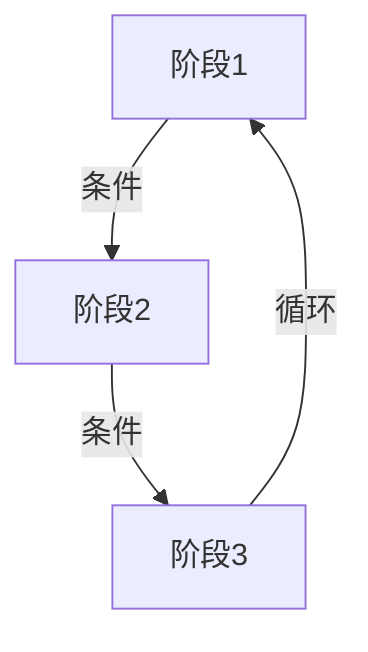
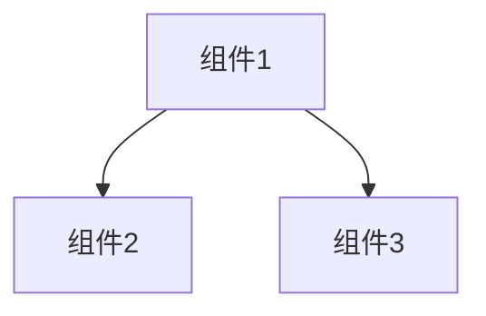

# wurong98.github.io 写作风格

## 概述

这是作者 wurong 的博客写作风格指南，适用于信息论、投资、区块链等主题的深度文章。

## 核心风格特征

### 文章结构

1. **章节分隔**：使用 `⸻`（Unicode分隔符）分隔大章节
2. **编号格式**：中文数字编号（一、二、三...）或阿拉伯数字
3. **层级标题**：使用 `##` 和 `###` 区分章节层级
4. **引言/背景**：文章开头描述现象或问题背景
5. **层层递进**：从现象到本质，从浅入深

### 格式规范

- **加粗强调**：关键观点用 `**加粗**` 突出
- **数学公式**：LaTeX 格式，使用 `$$...$$`，需在 frontmatter 设置 `math: true`
- **Mermaid 图**：流程图、示意图，需在 frontmatter 设置 `mermaid: true`
- **列表**：使用 `-` 或 `*` 作为列表标记

### 写作视角

- **第一人称**：常用"我"表达个人思考和学习心得
- **学习心得小节**：在学习类文章中包含"学习心得"或"学习路径"小节
- **总结收尾**：文章末尾有总结性段落

### Frontmatter 格式

```yaml
---
title: "文章标题"
author: "wurong"
date: "YYYY-MM-DD HH:MM:SS"
categories: "分类"
tags: ["标签1", "标签2"]
math: true
mermaid: true
---
```

## 写作模板

### 深度分析类

```
---
title: "..."
author: "wurong"
date: "YYYY-MM-DD HH:MM:SS"
categories: "..."
tags: [...]
math: true
mermaid: true
---

## 引言/背景
描述现象或问题

⸻

## 一、[主题段]
内容...

⸻

## 二、[主题段]
内容...

⸻

## 三、[主题段]
内容...

⸻

## 总结
核心观点总结
```

### 学习笔记类

```
---
title: "..."
author: "wurong"
date: "..."
categories: "..."
tags: [...]
math: true
mermaid: true
---

## 引言
为什么学习这个

⸻

## 一、核心概念
概念解释 + 数学公式

## 二、原理分析
深入理解

## 三、学习路径（可选）
入门 → 进阶 → 应用

⸻

## 总结
核心收获
```

## 常用 Mermaid 模式

### 流程图（分析路径）



### 架构图（系统组成）



## 常见表达模式

- **引入**："...是一种..."，"...有一个很有意思的现象..."
- **转折**："...但..."，"...然而..."
- **强调**：**关键观点**，**核心要点**
- **总结**："...可以用一句话概括：..."，"...的核心是..."

## 不符合风格的写法

- ❌ 使用英文分隔符 `---` 代替 `⸻`
- ❌ 缺少 frontmatter 或格式不完整
- ❌ 没有加粗强调关键观点
- ❌ 缺少总结性段落
- ❌ 过于学术化而缺乏个人思考
