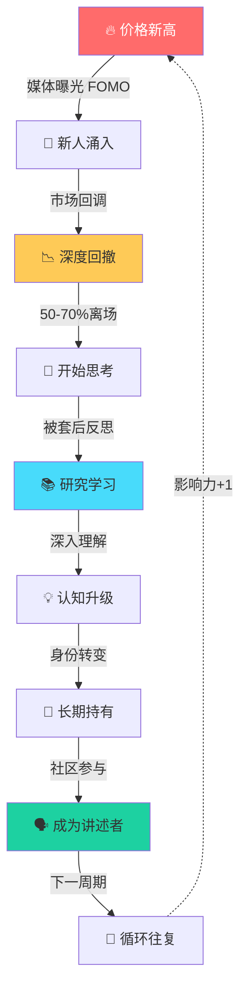

在 Bitcoin 的世界里，经常能看到一种很有意思的成长轨迹：

因为价格新高而关注，因为暴跌套住而学习，因为学习理解而坚定持有。

很多老玩家回头看自己的经历，几乎都走过类似的路径。

这不是个别现象，而是一种在比特币社区反复出现的模式。

⸻

## 一、进入：价格是最强的传播工具

绝大多数人第一次听说比特币，并不是因为技术。

而是因为价格。

当价格突破新高时，媒体开始报道，社交网络开始讨论，"错过恐惧"迅速扩散。很多人就是在这个阶段进入市场。

他们的初始动机很简单：
- 看见别人赚钱
- 害怕错过机会
- 想参与一把

这一阶段的人，其实很少真正理解比特币。

他们关注的往往只有一个问题：

**还能涨多少。**

⸻

## 二、震荡：市场成为最残酷的老师

但比特币市场有一个非常鲜明的特点——

波动极大。

牛市吸引来的新参与者，往往会很快经历一次深度回撤。有的人在恐慌中离开，但也有一部分人，因为已经被套住，开始认真思考一个问题：

**我到底买了什么？**

于是，他们开始真正去研究：
- 为什么总量是 2100 万
- 为什么网络不需要中心机构
- 什么是 Proof of Work
- 什么是 Blockchain

很多人都是在被套之后，第一次认真阅读白皮书，或者开始了解整个系统的设计。

市场在这一刻，变成了一种特殊的教育机制。

⸻

## 三、理解：从价格到结构

当研究逐渐深入，一些人的关注点会发生变化。

最初他们关注的是价格，后来开始关注结构：
- 固定发行机制
- 去中心化网络
- 难度调整
- 抗审查属性

这时，比特币在他们眼中的意义，也开始变化。

从一开始的：**投机资产**

逐渐转变为：**一种新的货币实验。**

⸻

## 四、持有：从交易者到长期参与者

当认知稳定下来，一部分人会逐渐改变策略。

频繁交易变少了，取而代之的是更简单的方式：

**长期持有，或者定期买入。**

他们开始思考的问题也变了：
- 我希望未来持有多少 BTC
- 如何长期保管资产
- 如何参与生态建设

这时，比特币不再只是一个交易标的，而变成了一种长期配置。

⸻

## 五、传播：投资者变成讲述者

还有一个非常有趣的现象。

当一个人真正理解比特币之后，往往会开始向别人解释它。

于是社区里出现了一种特殊的人：

**既是持有者，也是传播者。**

他们会：
- 写文章
- 做播客
- 在社交网络讨论
- 向朋友解释比特币

久而久之，这些人构成了社区中最稳定的一部分。

⸻

## 六、一个不断循环的过程

如果把这个过程抽象出来，大致会形成一个循环：

这个循环有几个关键特征：

**1. 自然的筛选机制**  
不是所有人都能坚持下去。暴跌会筛掉投机者，留下那些愿意思考和学习的人。

**2. 质量的螺旋上升**  
每一轮循环，能够坚持到最后的人，对比特币的理解都比上一轮的"坚持者"更深。

**3. 传播的复利效应**  
这些成为传播者的人，会在下一轮牛市中影响新一批进入的人。他们不再是孤立的信仰者，而是互相支撑的社区。

**4. 时间是必然的成本**  
没有人能跳过任何一个环节。每一个真正的长期持有者，都必然经历过被套、疑惑、研究、顿悟这整个过程。

⸻

## 七、为什么这个路径很重要

这个观察有几个启示：

**1. 市场震荡不是失败，而是教育**  
暴跌对新手来说是痛苦的，但也是他们真正理解资产价值的最好机会。那些被套住的人，往往比那些没赔钱的人，最终对比特币的认知更深。

**2. 时间是关键变量**  
同样买比特币，有的人炒卖，有的人持有。结果往往差很大。那些坚持到理解阶段的人，通常能跨越几个完整周期。

**3. 理解才能坚定**  
没有理解的信仰常常在波动中崩塌。但一旦真正理解了比特币的设计逻辑，再大的跌幅也很难动摇。

**4. 社区的力量来自这样的人**  
比特币社区最强大的地方，不在于最初的信仰者有多少，而在于每个周期后，有多少人从投机者变成了传播者。
