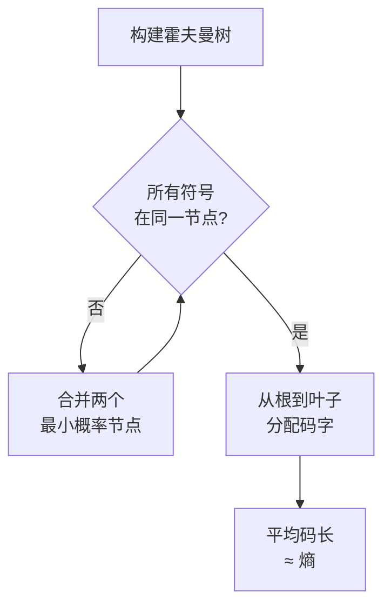
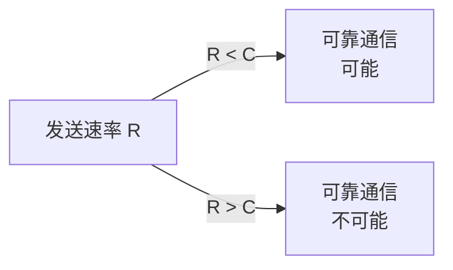

⸻

## 引言：为什么是香农

克劳德·香农在 1948 年发表的那篇论文《通信的数学理论》（A Mathematical Theory of Communication），可能是二十世纪最重要的单篇论文之一。

在此之前，"信息"这个词在工程领域含义模糊——工程师们处理的是信号、噪声、带宽，但从来没有一个清晰的数学量来度量"信息"本身。香农做了一件极其大胆的事：**他用数学定义了信息。**

这个定义不仅改变了通信理论，还深刻影响了密码学、计算机科学、物理学，甚至我们今天讨论的"人工智能"都和他留下的遗产密切相关。

本文记录了我对香农主要技术贡献的学习过程，包括熵的定义、信道编码定理、密码学理论，以及推荐的学习资源。

⸻

## 一、熵：信息的数学度量

### 1.1 从"惊喜"到"信息"

香农面临的核心问题是：**信息能否被量化？**

直觉上，信息和我们对消息的"意外程度"有关。一个必然发生的事件（比如"太阳从东方升起"）不包含信息，因为我们已经知道它会发生。而一个极少发生的事件（比如"彩票中大奖"）包含大量信息，因为我们此前对它几乎一无所知。

香农借用热力学的概念，把这个度量叫做 **熵（Entropy）**，记作 $H$。

对于一个离散随机变量 $X$，其取值集合为 $\{x_1, x_2, ..., x_n\}$，对应的概率分布为 $P(x_i)$，香农定义熵为：

$$H(X) = -\sum_{i=1}^{n} P(x_i) \log_2 P(x_i)$$

这里对数的底数通常是 2，得到的单位是 **比特（bit）**。

### 1.2 熵的含义

熵的几条重要性质：

1. **非负性**：$H(X) \geq 0$
2. **确定性事件**：当 $P(x_i) = 1$ 时，$H(X) = 0$（没有不确定性，就没有信息）
3. **最大熵**：在离散情况下，当所有事件等概率时，熵达到最大值 $\log_2 n$

第三条尤为重要——这说明**均匀分布是最"不可预测"的分布**。这个洞察成为后续压缩理论和编码定理的基础。

### 1.3 一个例子

假设一个字母表中只有两个符号：A 和 B。

- 如果 $P(A) = 1, P(B) = 0$，那么 $H = -1 \cdot \log_2 1 = 0$
- 如果 $P(A) = 0.5, P(B) = 0.5$，那么 $H = -2 \cdot 0.5 \cdot \log_2 0.5 = 1$ 比特

这符合直觉：当两个符号等概率出现时，每个符号恰好携带 1 比特信息。

如果符号不是等概率的呢？比如 $P(A) = 0.75, P(B) = 0.25$：

$$H = -(0.75 \log_2 0.75 + 0.25 \log_2 0.25) \approx 0.811 \text{ 比特}$$

这意味着我们可以"节省"空间——如果用某种编码让出现概率高的符号用更短的表示，我们可以平均用不到 1 比特来表示一个符号。**这正是香农第一定理——信源编码定理——的起点。**

### 1.4 学习心得

理解熵的最大难点在于：**它不是"信息的总量"，而是"不确定性的度量"。**

初学者容易犯的错误是把熵理解为"这条消息有多少信息"。正确理解应该是：**熵描述的是信源的整体统计特性，而不是任何特定消息的内容。**

一个确定性的信源（每次输出相同）熵为 0，不是因为它没有信息，而是因为它的输出没有不确定性——我们不需要"学习"任何新东西。

⸻

## 二、香农第一定理：信源编码定理

### 2.1 问题的提出

假设我们有一个信息源，它输出英文字母。我们能否找到一种编码方式，把字母转换成二进制序列，使得平均编码长度尽可能短？

香农第一定理回答了这个问题：**平均编码长度的下限就是熵。**

形式化地说：设信源熵为 $H$，则任何无失真编码的平均码长 $L$ 满足：

$$H \leq L < H + 1$$

这个定理的深层含义是：**我们无法超越熵的限制来压缩信息。** 熵是信息量的根本下界。

### 2.2 霍夫曼编码：接近极限

虽然香农给出了理论极限，但具体的编码方法需要后来者发展。霍夫曼编码（Huffman Coding）是一种最优前缀码，其平均码长可以非常接近熵。

霍夫曼编码的思路是：给出现概率高的符号分配短的码字，给出现概率低的符号分配长的码字。

### 2.3 学习心得

信源编码定理让我重新理解了"压缩"这件事：

压缩的本质不是"减少信息"，而是**用更高效的符号表示信息**。被压缩后的数据仍然包含原始的全部信息——只是我们用了更"聪明"的表示方式。

这也解释了为什么有损压缩可以大幅减少数据量：有损压缩实际上是在**丢弃一些信息**，让熵降低，从而可以压缩得更狠。

⸻

## 三、香农第二定理：信道编码定理

### 3.1 噪声信道的问题

现实中的通信信道有噪声。发送端发出信号，接收端收到的可能是被噪声干扰后的版本。

香农第二定理（信道编码定理）回答的问题是：**在有噪声的信道上，可靠通信的最大速率是多少？**

答案是：**信道容量（Channel Capacity）**，记作 $C$。

$$C = \max_{P(x)} I(X; Y)$$

其中 $I(X; Y)$ 是输入 $X$ 和输出 $Y$ 之间的互信息（Mutual Information）。

### 3.2 形式化的表述

信道编码定理的内容是：

对于任意 $\epsilon > 0$，当传输速率 $R < C$ 时，存在一种编码方式，使得错误概率小于 $\epsilon$。反之，如果 $R > C$，则任何编码方式的错误概率都无法降到零。

这个定理的伟大之处在于：**它证明了噪声信道上的可靠通信是可能的。** 这在香农之前并不是显然的。

### 3.3 编码定理的几何直观

理解信道编码定理的一个直观方式是把它想象成在高维空间中的"球填充"问题：

- 发送的码字可以看作是 $n$ 维空间中的点
- 由于噪声，每个码字会"扩散"成一个球
- 两个码字的球不能重叠，否则接收端无法区分
- 球的大小由信道噪声决定（噪声越大，球越大）
- 在给定空间中能容纳多少个不重叠的球，就决定了容量 $C$

### 3.4 学习心得

信道编码定理给我最大的冲击是：**它证明了"随机"的力量。**

香农的证明使用了"随机码"（Random Code）的概念——不是精心设计的码，而是从所有可能的码字中随机选取的。这种随机码在 $n \to \infty$ 时表现出近乎完美的性能。

这个洞见影响了后续几乎所有信道编码方案：LDPC 码、Turbo 码，都是在某种随机或准随机结构中找到了接近香农极限的性能。

⸻

## 四、香农的密码学贡献

### 4.1 完美安全

香农在 1949 年发表了另一篇奠基性论文《保密通信的数学理论》（Communication Theory of Secrecy Systems）。在这篇论文中，他形式化地定义了 **完美保密性（Perfect Secrecy）**：

$$P(M|C) = P(M)$$

这意味着给定密文 $C$，对明文 $M$ 的后验概率与没有看到密文时的先验概率相同。换句话说：**密文不透露任何关于明文的信息。**

### 4.2 一次性密码本

香农证明了实现完美保密的唯一方法是 **一次性密码本（One-Time Pad）**：

- 密钥长度至少和明文一样长
- 密钥完全随机
- 密钥只使用一次

一次性密码本的加密和解密过程是简单的异或操作：

$$C = M \oplus K$$
$$M = C \oplus K$$

香农给出的是一个存在性证明：**如果你想要完美安全，你必须接受这些限制。** 这为后来的密码学发展划定了一条清晰的红线——我们不可能在"便利性"和"完美安全"之间兼得。

### 4.3 扩散与混淆

除了完美保密，香农还提出了两个重要的密码设计原则：

- **扩散（Diffusion）**：明文的每一位应影响密文的多位
- **混淆（Confusion）**：密钥和密文之间的关系应尽可能复杂

这两条原则直接影响了后续对称密码的设计，尤其是 DES 和 AES。

### 4.4 学习心得

香农的密码学工作让我理解了**理论指导实践的力量**。

在香农之前，密码学更多是"艺术"——设计一些看起来复杂的变换，希望敌人无法破解。香农把密码学变成了"科学"——先定义什么是"安全"，然后证明某个方案是否满足这个定义。

一次性密码本在实践中很少使用（因为密钥分发太困难），但它给出的理论极限一直是密码学家的北极星。每当有人声称设计了一个"新"的加密算法，我们首先要问：**它比一次性密码本更安全吗？还是只是在某些方面做了权衡？**

⸻

## 五、香农与人工智能

### 5.1 智能的"信息论"视角

香农晚年对"机器能否思考"这个问题很感兴趣。他设计了一个叫"Thy Shannon"的机器，可以下棋；还设计了一个"随机老鼠"的迷宫实验，试图用信息论方法研究学习。

这些工作在当时看来很有趣，但并未引起太多关注。

### 5.2 熵与机器学习

今天回看，香农的熵概念在机器学习中无处不在：

- **决策树**：用信息增益（本质是熵减）来选择分裂特征
- **最大似然估计**：等价于最小化交叉熵
- **变分自编码器（VAE）**：用 KL 散度度量分布差异
- **语言模型**：困惑度（Perplexity）本质上是 $2^{H}$

可以说，**机器学习的核心就是在处理和度量信息**。

### 5.3 学习心得

我曾经觉得信息论是"老古董"，是通信工程师的东西。真正深入学习后才发现，信息论是理解现代人工智能的一把钥匙。

特别是近年来大语言模型的火热，让我们重新认识到：**语言模型本质上是一个巨大的概率分布，学习的本质就是降低模型对训练数据的条件熵。**

⸻

## 六、我的学习路径

### 6.1 入门阶段

我的信息论学习始于 Thomas Cover 的《信息论基础》（Elements of Information Theory）。这本书是经典的教材，数学推导严谨，但循序渐进，适合有一定数学基础的学习者。

**关键章节**：
- 第二章：熵与互信息
- 第三章：信源编码定理
- 第四章：信道编码定理
- 第五章：信息论与统计学的关系

### 6.2 进阶阶段

有了基础后，我开始阅读香农的原始论文。1948 年的《通信的数学理论》值得反复研读——尽管符号和写法有些过时，但核心思想极其清晰。

**推荐资源**：
- 香农原始论文（1948）：可在此下载（Harvard 数学系存档）
- MacKay 的《Information Theory, Inference, and Learning Algorithms》：更现代的视角，包含贝叶斯推断

### 6.3 应用阶段

为了加深理解，我还尝试把信息论应用到具体领域：

- **数据压缩**：实现霍夫曼编码和 LZ77 算法
- **信道编码**：学习 LDPC 码的构造和译码算法
- **密码学**：用 Python 实现一次性密码本和简单分组密码

实践是检验理解的最好方式。很多在阅读时"觉得懂了"的概念，在实现时才会发现漏洞。

### 6.4 持续学习

信息论是一个仍在发展的领域。近年来的信息瓶颈理论（Information Bottleneck）、信息论因果推断等方向都很活跃。

推荐关注：
- Naftali Tishby 的信息瓶颈理论
- 统计力学和信息论的交叉

⸻

## 七、总结

香农的工作可以用一句话概括：**他给了我们度量信息的数学语言。**

在此之前，"信息"是一个模糊的直觉概念；在此之后，信息变成了一个可以精确计算、严格推导的数学对象。

从熵到信道编码定理，从完美保密到扩散混淆，香农留下的遗产定义了现代通信和密码学的基本范式。而他对"智能"的早期探索，也在这个 AI 爆发的时代获得了新的意义。

对于学习者而言，香农的文章和著作是取之不尽的宝库。它们不仅包含了具体的技术知识，更展示了**一种用数学思维处理工程问题的范式**——先定义问题，建立数学模型，推导极限，然后设计具体方案来逼近这些极限。

这种思维方式，或许比任何具体定理都更有价值。

⸻

## 参考资料

1. C. E. Shannon, "A Mathematical Theory of Communication", *Bell System Technical Journal*, 1948
2. C. E. Shannon, "Communication Theory of Secrecy Systems", *Bell System Technical Journal*, 1949
3. Thomas M. Cover, *Elements of Information Theory*, 2nd Edition, 2006
4. David J. C. MacKay, *Information Theory, Inference, and Learning Algorithms*, 2003
